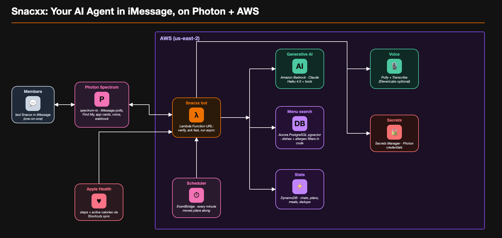

# HackLanta '26: iMessage dining agent

Your friend who checks the menu before you do. Text it a menu or food photo, ask what to eat, or start a group poll, all inside iMessage.

| Folder | What it is |
|---|---|
| [`bot/`](bot/) | iMessage bot server (Node/TypeScript, Photon Spectrum, Gemini). Setup and run instructions are in [`bot/README.md`](bot/README.md). |
| `src/`, `scripts/`, `tests/`, `infra/` | AWS backend: allergen-safe dish retrieval (RAG over pgvector). **Work in progress, see [Backend status](#backend-status-honest-version).** |
| [`data/`](data/) | Scraped catalog of 9 GSU-area restaurants and the script that builds it. |

## Architecture



Snacxx is an iMessage agent built on [Photon Spectrum](https://photon.codes/spectrum) (`spectrum-ts`) and AWS. Photon delivers each
message to a Lambda Function URL, which answers fast and runs the work asynchronously: Claude on Bedrock picks the tools, allergens
and diets are filtered in code against Aurora pgvector, state lives in DynamoDB, and an EventBridge rule moves meal plans along every
minute. Editable source: [`docs/snacxx-architecture.drawio`](docs/snacxx-architecture.drawio) (open it in draw.io).

## Quick start

```bash
cd bot
npm install
cp .env.example .env   # add Photon + Gemini keys
npm run dev
```

Secrets live only in `bot/.env`, which is git-ignored. Never commit real keys.

## Backend status (honest version)

The AWS backend is **partly built**. The part that decides *which dishes are safe and relevant* works and is tested. The
part that connects it to iMessage does not exist yet. Today the live bot is still the Gemini bot in `bot/`; it does **not**
use any of this.

### What works

Given a text like "allergic to peanuts, recommend Thai", the code can: parse it with Claude Haiku 4.5 on Bedrock, merge it
with stored restrictions, search a pgvector table for matching dishes, re-check every result in code, rank them, have the
model pick 3 and write one line each, and format a reply with Apple Maps links. You can run that today from a terminal:

```bash
npm install
cp .env.example .env            # fill in DB_CLUSTER_ARN and DB_SECRET_ARN from the dining-vector-db stack outputs
npm run ingest                  # embed data/gsu_dishes.csv into pgvector (re-run when the CSV changes)
npm run search -- "allergic to peanuts, recommend thai"
npm test                        # 44 unit tests, no AWS needed
npm run eval                    # 26 live cases against the real database and model
```

| Piece | Where | State |
|---|---|---|
| pgvector database (Aurora PostgreSQL Serverless v2, Data API, scales to 0 when idle) | `infra/vector-db.yaml` | Deployed in account `446205069613`, `us-east-2` |
| Catalog loader, de-duplication, item kinds, cuisine tags | `src/data/` | Done. 825 scraped rows become 757 dishes |
| Embeddings (Titan Text v2, 1024 dims) and retrieval | `src/rag/` | Done |
| Parse, route, filter, score, pick, format | `src/pipeline/` | Done |
| Unit tests and live eval | `tests/`, `scripts/eval.ts` | 44 unit tests pass. Eval: 26 cases, 0 allergen leaks |

### How safety works

- **Allergens and diets are hard filters in code, not LLM judgments.** They are enforced in the SQL `WHERE` clause and again
  in a separate pure function on whatever comes back. Similarity only ranks dishes that already passed.
- **A blank allergen field means unknown, and unknown is excluded** for anyone with an allergy.
- **Ingredient words in the name and description are also checked** (for example "peanut", "cashew", "shrimp"), because
  the allergen cell is wrong or incomplete for some rows. This was added after an audit found 37 dishes whose text mentioned
  an allergen their cell omitted.
- **The model can only pick dish IDs that retrieval returned.** Invented or duplicate IDs are dropped, and a reason that
  claims a dish is "safe" or "allergen-free" is replaced.
- Replies about allergies end with a "confirm with the restaurant" note, and dishes whose allergen data is only estimated
  say so. Group replies say "works for everyone's restrictions" and name no one.
- The tests were checked by deliberately breaking the safety code; they fail when it is broken.

### What does NOT work or does not exist yet

- **No iMessage integration for this backend.** There is no webhook Lambda, no SQS queue, no worker Lambda, no deduping of
  messages and no `template.yaml`. Photon supports signed webhooks, so the design in `CLAUDE.md` is feasible, but none of it
  is written.
- **No user profiles.** There is no DynamoDB, no onboarding, and no group-chat handling. The pipeline accepts merged
  restrictions as an input; nothing stores or merges them yet. The CLI fakes them with `--allergy`, `--diet`, `--budget`.
- **No real location or walking times.** The distance is a straight-line estimate and only used when you pass `--lat/--lng`.
  Google Maps, "open now" and the 1.5 km filter are not built.
- **Follow-ups ("cheaper", "#2") are parsed but not acted on.** Nothing remembers the last results.
- **The proactive "ping the user based on their health profile" idea is not built** and would need a scheduler.
- **No ratings in the data**, so the rating part of the scoring formula is replaced by similarity to the request.

### Known limits of the data and the approach

- **The data is thin for dietary queries.** Only 98 dishes carry a vegetarian or vegan tag and 93 of those have no price.
  India Eats has 147 dishes and none are tagged. A vegetarian user with a budget often gets nothing, and the bot says so
  and does not guess. `gluten_free` has 3 dishes, `halal` and `kosher` have none.
- **Allergen coverage is conservative, so it hides good food.** 244 dishes have blank allergens and are excluded for anyone
  with an allergy. Non-dairy items such as "Nondairy Vanilla Sweet Cream Cold Brew" are hidden from dairy-allergic users
  because the text contains "cream". "Eggplant" and "oyster mushrooms" are hidden for egg and shellfish allergies.
- **Most allergen data is not from the restaurants.** 457 of 825 rows are `estimated` and 21 are `inferred`; only `chart`,
  `ingredients` and `menu_text` come from the restaurant. The reply flags estimated data, but this is the weakest link in
  the project's safety story. It is not a substitute for asking the restaurant.
- **A food-allergy tool is only as safe as its data.** The eval proves the code does not return dishes that the data says
  contain an allergen. It cannot prove the data is right.
- **Retrieval quality is middling.** Titan similarity scores on short dish text are low (0.2 to 0.4), and a query like
  "spicy chicken" mostly works because of the filters and the kind/cuisine tags. The 26-case eval measures safety far
  better than it measures whether the suggestions are good. Nobody has judged recommendation quality yet.
- **Prices are missing for about half the catalog** (Starbucks has none). With a budget set, unpriced dishes are excluded.
- **Cuisine tags are hand-written per restaurant** in `src/data/cuisines.ts`. A new restaurant needs a new line.
- **Scale:** 757 rows are scanned exactly, with no vector index. That is intentional and fine here; it would not scale to
  a large catalog.

### Infrastructure notes

- Account `446205069613` was upgraded from the Free plan to the Paid plan, because Aurora cannot be created normally on the
  Free plan. Your $100 credits still apply.
- Only older Claude models work on this account: Haiku 4.5, Sonnet 4.5/4.6, Opus 4.5/4.6. The 5.x models and Opus 4.7/4.8
  return "not available for this account". `BEDROCK_MODEL_ID` is `us.anthropic.claude-haiku-4-5-20251001-v1:0`.
- The Aurora cluster costs storage only while idle. To remove it:
  `aws cloudformation delete-stack --stack-name dining-vector-db --region us-east-2`
- `CLAUDE.md` still lists vector search and embeddings as out of scope; that no longer matches this branch.
- This branch adds two npm dependencies: `@aws-sdk/client-bedrock-runtime` and `@aws-sdk/client-rds-data`.

### Next steps, in order

1. Webhook Lambda (verify the Photon HMAC, dedupe, enqueue) and worker Lambda, with a `template.yaml`.
2. DynamoDB `Users` / `Threads` / `ProcessedMessages`, onboarding, and group-chat merging.
3. Google Routes walking times and a real location flow.
4. Decide how to improve diet tagging and allergen data quality (needs a human decision; it is not safe to guess).
5. Have a person judge the quality of real recommendations.

## Saving AI tokens with graphify

This repo ships a [graphify](https://github.com/safishamsi/graphify) code map (`graphify-out/graph.json` + `GRAPH_REPORT.md`) so Claude Code can query the codebase structure instead of re-reading files. One-time setup per teammate:

```bash
uv tool install graphifyy    # installs the `graphify` CLI
graphify hook install        # git hooks: rebuild the map after each commit/checkout (local only)
```

- Claude Code picks it up automatically via `.claude/settings.json` and the `CLAUDE.md` rules (the hook is skipped if graphify isn't installed).
- Ask questions with `graphify query "how does X work"`, `graphify explain "annotateFood"`, `graphify path "handle" "sendDayCard"`.
- After code changes: `graphify update .` (local AST parsing, no API key or cost). Commit the refreshed `graph.json`/`GRAPH_REPORT.md` with `git add -f`.
